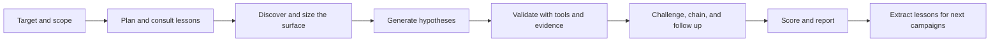

# WebPent — صياد ثغرات ويب يعمل بنفسه

> 🧬 **إصدار الدمج الموحد — UNIFIED MERGE (2026-11-02):** هذه الشجرة تجمع **أربع نسخ من
> المشروع في ملف واحد**: الأساس **ULTIMATE 0.34.0** كاملًا + كل المميزات والإصلاحات الفريدة
> في **v15.2 MERGED R4** و**l10 WIP (0.12.0)** و**v4 start (0.3.0)**. ملفات 0.34.0 المجمدة
> (659 ملفًا) نُسخت بايت-ببايت وبوابات الـfrozen-manifest سليمة. التفاصيل الكاملة في
> [`MERGE_REPORT.md`](MERGE_REPORT.md) وقسم «نسخة الدمج الموحد» تحت.

وجّهه إلى هدف **مُصرَّح لك** باختباره، وهو يخطط، يستكشف، يولّد فرضيات، يتحقق منها بأدوات
حقيقية، ويُخرج تقرير bug-bounty جاهزًا للتسليم — كل خطوة مبنية على evidence حقيقي لا
تخمين. مبني كطبقات agents فوق LangGraph (80+ عقدة) بدقة هندسية عالية: آلاف الاختبارات،
redaction فوري لكل قيمة حساسة، وصفر تعامل لبيانات خارجية كتعليمات تنفيذ.

> ⚠️ **تنبيه قانوني — اقرأه قبل أي تشغيل:** استخدم WebPent فقط على أنظمة تملكها أو
> لديك تصريح كتابي لاختبارها. التشغيل الفعلي يتطلب تمرير `--authorization`، ولا يُنفَّذ
> أي طلب نشط خارج ملف الـscope المصرَّح به. لا تستخدمه ضد أهداف عامة أو أنظمة طرف
> ثالث دون تفويض صريح.

**[⚡ ابدأ في 3 دقائق](#ابدأ-في-3-دقائق) · [🧭 اختار أمر الفحص](#اختار-أمر-الفحص) · [🧠 ازاي يشتغل](#ازاي-يشتغل) · [🧪 جرّبه على lab آمن](docs/architecture_simple.md) · [🩺 عندي مشكلة](#doctor-وdebugging-runbook) · [🧬 نسخة الدمج الموحد](#نسخة-الدمج-الموحد-2026-11-02)**

---

## نسخة الدمج الموحد (2026-11-02)

هذه الشجرة نتيجة دمج موثق لأربع نسخ من المشروع في شجرة واحدة (**4,643 ملفًا**) وفق
سياسة «الأحدث يفوز + اتحاد كامل»: كل مسار غير موجود في الأساس أُحضر من أحدث نسخة
تملكه بنفس مساره الأصلي، وكل التعارضات (666 ملفًا) حُسمت لصالح خط 0.34.0، و36 ملفًا
مكررًا حرفيًا استُبعدت لوجود محتواها مؤرشف أصلًا. لا يوجد أي محتوى من أي نسخة أُسقط.

| النسخة المصدر | دورها في الخط الزمني | أبرز ما أضافته لهذه الشجرة |
|---|---|---|
| **ULTIMATE 0.34.0 r2** (2026-11-02) | الأساس — الأحدث والأكمل (6,740 اختبارًا) | كل شيء: dojo/econ/jc/prism/vip/production/dashboard وبوابات الجودة وإصلاحات red-team R2 |
| **v15.2 MERGED R4** (2026-11-01) | خط فرعي بعمل تحصين خاص | وكيلان جديدان `agents/cache_poisoning` و`agents/prototype_pollution` + اختبارات R4/R6 + بوابات `pip-audit` و`check_build_info_honesty` + أرشيف إثباتات التعميم (DVWA/WebGoat/Juice Shop/CRAPI) |
| **l10 WIP 0.12.0** (2026-10-30) | نسخة عمل وسطى (معالم L7–L10) | حزم `appsuite/` و`labsuite/` وملفات `egaie` الأساسية (assertions/planner/prerequisites/workflow_discovery/benchmark) + اختباراتها — **كانت مراجعها معلّقة في Makefile نسخة 0.34.0 واكتملت بهذا الدمج** |
| **v4 start 0.3.0** (2026-10-22) | نقطة البداية | طبقة legacy كاملة: `oast/` و`safety/` و`scheduler/` و`targeting/` و`waf_evasion/` و`workflow_fuzzing/` و`secrets_scanner/` وagents القديمة و~45 اختبارًا |

**خمسة ملفات دُمجت يدويًا على مستوى المحتوى** (بدل اختيار نسخة واحدة): `Makefile`
(هدف `tool-boundary-gate`)، `.github/workflows/ci.yml` (خطوتا Playwright Chromium
وBuild-info honesty مع الإبقاء على كل بوابات 0.34.0)، `.gitignore` (استثناءات
P2-404)، `.env.example` و`.env.llm.example` (اتحاد المفاتيح). النتيجة النحوية:
2,465 من 2,466 ملف بايثون سليم (الاستثناء قالب `@@…@@` مقصود في النسخ الأربع كلها).

> 📄 **كل التفاصيل — السياسة والإحصائيات وملاحظات التكامل — في
> [`MERGE_REPORT.md`](MERGE_REPORT.md).** للتحقق السريع بعد التثبيت انظر
> قسم «تحقق الدمج الموحد» في قسم الاختبارات تحت.

---

## ابدأ في 3 دقائق

```bash
git clone <repo> && cd webpent
./install.sh          # يسأل سؤال أو اتنين ويجهز كل حاجة (راجع التفاصيل تحت)
webpent init          # إعداد موجه تفاعلي: هدف + تفويض + وضع الفحص
webpent hunt --url https://your-authorized-target.com --mode standard --authorization "your written authorization ref"
```

أبسط صورة للتثبيت اليدوي (بديل عن `install.sh`):

```bash
python3 -m venv .venv && . .venv/bin/activate
pip install -e ".[dev]"
cp .env.minimal.example .env    # 10 أسطر بس للمبتدئ — .env.example الكامل للتخصيص المتقدم
```

لا يوجد مفتاح LLM؟ يعمل. المسار الحتمي (deterministic) لا يحتاج أي API key:

```bash
export LLM_ENABLED=false
```

## اختار أمر الفحص

الأمر الموحّد `webpent hunt` هو نقطة الدخول الوحيدة الموصى بها (الاقتراح 1 من خطة
Ultimate 2026-10-27 — توحيد المحرك). الأوضاع الثلاثة تحدد الميزانية (خطوات/وقت/تكلفة)
بقيم مدروسة، مع ميزانية خطوات **ديناميكية** مشتقة من حجم سطح الهدف الفعلي (اقتراح 2)،
واستشارة دروس الحملات السابقة قبل التخطيط (اقتراح 3):

| عايز إيه؟ | الأمر |
|---|---|
| فحص سريع، تقرير في دقائق | `webpent hunt --url <target> --mode quick --authorization <ref>` |
| فحص عميق متوازن (**الافتراضي الموصى به**) | `webpent hunt --url <target> --mode standard --authorization <ref>` |
| فحص شامل طويل لتطبيق كبير | `webpent hunt --url <target> --mode deep --authorization <ref>` |

خلال التشغيل تشوف شريط تقدم حي بالمرحلة الحالية وعدد الـfindings والتكلفة لحظيًا،
وكل finding مؤكد يظهر فورًا في سطر لحظة ترقيته لـCONFIRMED — مش مستني التقرير النهائي
(اقتراح 12).

**الأوامر القديمة** (`scan`, `hunt-auto`, وشكل `hunt` التخطيطي القديم)
**اتشالت في v0.32.0** (النافذة المعلنة في بند ج.2 من 0.30.0). الأمر الموحد
`webpent hunt` هو مدخل التشغيل الوحيد؛ الصياد المحدود بقى مكتبة API
(`webpent.autonomous`) وعدّاء الصياد بقى شغال عبر `webpent agent-hunt`.

| أوامر مساعدة | الوظيفة |
|---|---|
| `webpent init` | إعداد موجه تفاعلي لأول حملة (اقتراح 13) |
| `webpent doctor` | فحص صحة التثبيت: DB، مفاتيح LLM، الأدوات الخارجية |
| `webpent llm-keys add/test` | إدارة مفاتيح المزودين |
| `webpent scope add/check` | إدارة ملف النطاق المصرَّح به |
| `webpent retest list` / `retest finding <ID>` | إعادة اختبار منضبطة لنتيجة سابقة داخل النطاق المصرَّح به (مسار 11.7): تصريح + ملف نطاق إلزاميان، إعادة تشغيل واحدة للطلب المخزَّن، حكم حتمي، وسجل مقارنة |
| إشعارات التأكيد (مسار 11.8) | تنبيه لحظة تأكيد finding إلى قناة تختارها: webhook موقَّع (WEBHOOK_ENABLED+WEBHOOK_URL) و/أو صندوق JSONL محلي (WEBPENT_NOTIFICATION_FILE_PATH) — بلا تفاصيل حساسة افتراضيًا، ومعطّل كليًا افتراضيًا |
| `webpent oracle \| apex \| jc \| dojo \| econ \| cem \| prism ...` | طبقات التحليل المتقدمة (l6) |

## ازاي يشتغل

تمر الحملة بالتخطيط، والمصادقة، والاستطلاع، والزحف، وفهم الهدف، وقياس حجم السطح
(لحساب الميزانية الديناميكية)، واستشارة دروس الحملات السابقة، وتوليد الفرضيات،
والـprobes، والتحقق من الأدلة، والمتابعة المحدودة، والتقييم، والتأمل (مع استخلاص
دروس جديدة)، ثم **بوابة منع التكرار قبل الترشيح** (مسار 11.5: مراجعة نتائج
الحملات السابقة لنفس الـengagement — المكرر لا يُرشَّح للتقرير، يُعرض في ملحق
صريح بمرجع النتيجة السابقة، وفشل قراءة القاعدة لا يكتم شيئًا أبدًا)، والتقرير.
يفصل التصميم بين بيانات السطح والفرضيات والأدلة والعلاقات
والـFindings المؤكدة:

| مفهوم الحالة | الاستخدام |
|---|---|
| **Crawled data** | Endpoints وforms وheaders ومراجع JavaScript وحقائق السطح الأخرى. |
| **Surface observation** | إشارة سلبية إلى احتمال وجود فئة ثغرات؛ لا تُعد Finding وحدها. |
| **Hypothesis** | فكرة قابلة للاختبار قد تُرقّى أو تُرفض أو تظل inconclusive. |
| **Canonical evidence** | Request أو response أو tool result أو artifact راجعه إنسان بعد توحيده. |
| **Relational evidence** | علاقة typed بين identities أو resources أو requests أو findings. |
| **Finding** | نتيجة اجتازت قواعد evidence وconfidence والـvalidation. |



القاعدة الصارمة: **لا مكوّن يرقّي فرضية غير متحققة إلى ثغرة مؤكدة** — الترقية تتطلب
evidence مؤكدة بأداة حتمية أو artifact راجعه إنسان، والـLLM استشاري فقط يقترح ولا
يُقرّ أبدًا.

## القدرات الرئيسية

| المجال | الوضع الحالي |
|---|---|
| Workflow orchestration | Graph متعدد المراحل للتخطيط والاكتشاف والفرضيات والتنفيذ والتحقق والتأمل والتقرير، بميزانية خطوات ديناميكية. |
| حلقة التعلّم | استشارة دروس الحملات السابقة قبل التخطيط + استخلاص دروس جديدة عند التأمل + postmortem لكل false-positive. |
| BAC وAuthorization | Authorization matrix، role-aware severity، candidate expansion من query/body/header/GraphQL، وbounded adjacent-ID enumeration. |
| جودة الإثبات | عدم ترقية heuristic أو write-up إلى Finding بدون behavior فعلي وevidence وشروط التحقق المطلوبة. |
| Self-critique | Checkpoints عند فشل validation مع إبقاء النتيجة inconclusive بدل الترقية القسرية. |
| RAG | Knowledge Pack محلي للـmethodologies والـrepositories والـreports والwrite-ups. |
| LLM safety | محتوى RAG والبيانات الخارجية داخل trust boundary ولا يُعامل كتعليمات تنفيذ. |
| Memory isolation | عزل lessons حسب `client_id` مع تضييق اختياري حسب `engagement_id`. |
| Reporting | JSON وHTML وتقرير قابل للتوسعة مع authorization matrix appendix وredaction وملخص تنفيذي في أول التقرير. |
| Resumability | Checkpoints وthread state لاستكمال الحملات المنظمة. |
| فئات ثغرات موسعة (2026-10-27) | GraphQL (introspection/batching/field-suggestion/depth-DoS)، Cache Poisoning وWeb Cache Deception، Prototype Pollution، OAuth/SSO misconfiguration — كلها deterministic. |
| Recon موسع (2026-10-27) | أرشيف gau + nmap محدود ومصرَّح به + source-leak advisory (لا ينزّل كودًا أبدًا). |
| توافق قرارات الـLLM | agreement score استشاري للقرارات عالية الخطورة (افتراضيًا معطل). |
| تشغيل متوازٍ | rate governor عابر للحملات + portfolio dashboard + جدولة بأولوية. |
| مراقبة تشغيلية | `/api/v1/workers/status` + صفحة مراقبة حية للـCelery workers. |
| طبقة الدمج الموحد (2026-11-02) | كل مميزات النسخ الأربع في شجرة واحدة: حزم l10 المكمّلة (`appsuite`/`labsuite`/ملفات `egaie`)، وكيلا R4 الجدد، وطبقة legacy من v4 (`oast`/`safety`/`scheduler`/…) — جاهزة للاستخدام وغير مفعّلة في المعمارية النشطة افتراضيًا. |

## هيكل المشروع

```text
.
├── src/webpent/
│   ├── cqa_v2/              # CausalGuard وProofBundle وReplay (تُستخدم عبر ports)
│   ├── production/          # modern_spine.py (ختم sha256 لا يتحرك إلا بنقطة توثيقية)
│   ├── egaie/               # EGAIE: حلقة التحقيق المغلفة + البنشمارك المحلي
│   ├── oracle/              # طبقة الاستطلاع السلبي Zero-Touch
│   ├── verdict/             # حزمة معزولة (لا تُعدَّل)
│   ├── emulator/            # حزمة معزولة (لا تُعدَّل)
│   ├── rehearsal/           # حزمة معزولة (لا تُعدَّل)
│   ├── agents/              # عقد LangGraph؛ مجلد لكل مسؤولية
│   ├── api/                 # FastAPI routes وscan handling وworkers status
│   ├── cli/                 # CLI وعمليات الإدخال وinit التفاعلي
│   ├── config/              # الإعدادات وسياسات الأمان
│   ├── graph/               # بناء الرسم ومسارات التوجيه وميزانية الخطوات الديناميكية
│   ├── memory/              # Chroma وlessons وembeddings وretrieval
│   ├── models/              # النماذج وعقود الأدلة
│   ├── shared/              # confidence وsafety وauthorization وLLM helpers والكواشف الحتمية
│   ├── state/               # PentestState وUnifiedState وreducers
│   ├── tools/               # adapters واكتشاف الأدوات (nuclei/sqlmap/dalfox/katana/arjun/ffuf/subfinder/gau/nmap)
│   ├── validators/          # validators حتمية (GraphQL وOAuth)
│   ├── workers/             # Celery task entrypoints ومراقبة الـworkers
│   ├── appsuite/ labsuite/  # (دمج من l10) منصات التطبيقات والمختبرات + ملفات egaie المكمّلة
│   ├── oast/ safety/ scheduler/ targeting/ secrets_scanner/   # (دمج legacy من v4)
│   ├── waf_evasion/ workflow_fuzzing/ monitor/ resume/ benchmark/   # (دمج legacy من v4)
│   └── agents/cache_poisoning/ agents/prototype_pollution/   # (دمج من v15.2 R4)
├── knowledge_pack/          # corpus المحلي المنظم للـRAG
├── tests/                   # unit وintegration وsafety وregression
├── scripts/                 # doctor وingestion وverification
├── archive/                 # نماذج ما قبل v10 المؤرشفة (غير مستوردة، خارجه عن التعبئة)
├── audit/                   # coverage وreview وdelivery records
├── docs/                    # architecture وdebugging guides
├── knowledge_sources.yaml   # المصادر المعتمدة للمعرفة
├── Makefile                 # أوامر التشغيل المحلي وDocker
└── pyproject.toml           # metadata وdependencies وtooling
```

## المتطلبات

- Python **3.12**.
- Docker Compose عند استخدام الـstack الكامل (`./install.sh` يسألك).
- Redis للخدمات التي تعتمد على Celery أو rate limiting.
- Playwright/Chromium فقط لمسارات browser-based.
- LLM provider وembedding model اختياريان حسب مسار التشغيل (المسار الحتمي لا يحتاجهما).

لا تضع API keys أو cookies أو credentials في source أو reports أو ZIP أو رسائل الدردشة.

> **تنبيه (PRODUCTION_FIX_PLAN_0270 — D-2):** `credentials_template.json` في جذر
> المشروع **قالب قراءة فقط** لعقد بيانات الاعتماد (شكل owner/foreign) — لا تملأه
> بمفاتيح حقيقية ولا تنسخه المكان المفروض أن تعيش فيه الأسرار. بيانات اعتماد
> التشغيل الحقيقية تُدار حصرًا عبر `.env` (غير المتتبَّع، صلاحيات 0600 يجهزها
> `install.sh`) و`WEBPENT_USERS`، وأي نسخة مملوءة من القالب تُعد بيانات في
> المصدر ويجب حذفها فورًا.

## التثبيت

### الطريقة الأسهل — `install.sh` (اقتراح 11)

سكريبت تفاعلي واحد في جذر المشروع: يفحص المتطلبات (**Python 3.11+** — الأرضية
المعلنة في `pyproject.toml`؛ نافذة UM-DR-32 اختُبرت فعليًا تحت Python 3.12.16
موثّقة بمعزل عن الأرضية، Docker اختياري)،
يسأل سؤال أو اتنين بس (Docker أم محلي؟ مفتاح LLM دلوقتي أم بعدين؟)، ويجهز كل حاجة
بـdefaults آمنة موثقة. الأدوات الخارجية الاختيارية (nuclei، sqlmap، arjun، gau ...)
بتتفحص عند التشغيل بـ`webpent doctor` — غيابها يظهر كأداة غير متاحة، مش فشل صامت
في وسط حملة.

### يدويًا

```bash
python3 -m venv .venv
. .venv/bin/activate
python -m pip install --upgrade pip
pip install -e .                # أضف ".[recon-extra]" لأدوات arjun الإضافية
playwright install chromium     # مطلوب لمسارات المتصفح فقط
cp .env.minimal.example .env    # البداية السريعة (10 أسطر) — أو .env.example الكامل (201 سطر)
```

ملفات البيئة: `.env.minimal.example` (مفتاح LLM واحد + scope + DB افتراضي) للبداية،
و`.env.example` + `.env.llm.example` الكاملان للتخصيص المتقدم.

## Docker workflow

أسهل تجربة أولى: `docker compose --profile quickstart up` — أقل إعداد ممكن لأول حملة
خلال دقائق (اقتراح 11، المرحلة 4). السيناريوهات الكاملة كما هي: `docker-compose.yml`
(الإنتاج)، `docker-compose.dev.yml`، `docker-compose.test.yml`.

```bash
docker compose --profile quickstart up
# غيّر كل CHANGE-ME إلى secrets مستقلة قبل أي تشغيل حقيقي.
```

### وضع Rootless (D-1 — اختياري، 0.28.0)

لمنع الحاوية من حمل root في أي لحظة: أضف ملف الـoverride الجديد فوق ملف
الإنتاج بعد تصدير هويتك الحقيقية **صراحةً** (الـoverride يرفض البدء بدونها
بـ`:?` — لا سقوط صامت على 1000):

```bash
export WEBPENT_UID="$(id -u)"
export WEBPENT_GID="$(id -g)"
docker compose -f docker-compose.yml -f docker-compose.rootless.yml up -d
```

المقايضات معلنة في ترويسة الملف: لا معالجة ملكية آلية (مسارات الـbind-mount
يجب أن تكون مملوكة مسبقًا للـuid الهدف)، والـentrypoint يعلن `ROOTLESS MODE`
في السجل وينفّذ الأمر مباشرة. على المسار الافتراضي (root ثم gosu)، كل إقلاع
يُثبت السقوط بالسطر `privilege drop VERIFIED (uid=...)` — وأي فشل أو mismatch
يوقف الحاوية قبل تشغيل التطبيق (fail-closed).

## CLI وAPI

- `webpent init` — إعداد موجه تفاعلي: يسأل بالترتيب (URL الهدف مع فحص وصول فوري،
  تأكيد التفويض إلزاميًا، وضع الفحص، مزود LLM لو مش مُعد) ويطبع أمر الحملة الجاهز
  للنسخ بدل ما يشغلها بنفسه — بتتعلم الصيغة الصحيحة للمرة الجاية.
- `webpent hunt --url <t> --mode quick|standard|deep --authorization <ref>` — المحرك
  الموحّد (راجع [اختار أمر الفحص](#اختار-أمر-الفحص)).
- `webpent doctor` — فحص صحة ما بعد التثبيت.
- واجهة HTTP: `uvicorn webpent.api.app:app` مع `/docs` للـSwagger، و
  `GET /api/v1/workers/status` لمراقبة الـCelery workers (صفحة العرض الحية:
  `src/webpent/dashboard/workers_page.html`).

## الإعدادات الحساسة

انظر `.env.example` و`docs/CONFIGURATION.md`. القاعدة: كل secret يبقى في environment
أو key store — أبدًا لا يُكتب في artifacts أو التقارير، وكل قيمة parameter تخضع
للـredaction الفوري عند التسجيل.

## Knowledge Pack وRAG

```bash
PYTHONPATH=src python scripts/ingest_payloads.py
PYTHONPATH=src python scripts/verify_rag_knowledge_pack.py
```

محتوى الـknowledge pack يُعامل كـ**بيانات داخل trust boundary** — retrieval يغذي
الاقتراحات لكنه لا يُنفَّذ كتعليمات أبدًا.

## عزل الحملات والذاكرة

Lessons معزولة حسب `client_id` (مع تضييق اختياري حسب `engagement_id`)، والدروس
المستخلصة من فحص WordPress لعميل A تفيد فحص WordPress لعميل B عبر الاستشارة
المجردة من الـclient (دروس مبنية على بيانات decision-level لا raw payloads).

## أين يُستخدم الـLLM؟

الـLLM **استشاري فقط**: يقترح فرضيات ويفسر evidence ويصيغ تقارير — لكنه لا يقرر
ترقية أي finding. كل قرار ترقية يمر من validator حتمي. القرارات عالية الخطورة
(CRITICAL/HIGH) يمكن تعليمها بـagreement score استشاري عبر
`enable_llm_consistency_check` (افتراضيًا معطل لتوفير التكلفة).

## ضوابط الأمان

- scope enforcement على كل طلب (SSRF pinning + redirect guard)
- redaction فوري لكل قيمة parameter عند التسجيل
- `--authorization` إلزامية للتشغيل الفعلي
- أدوات البنية التحتية (nmap) خلف بوابة مزدوجة: flag + تأكيد scope صريح
- source-leak discovery استشاري بحت: لا ينزّل ولا يفحص كودًا أبدًا
- freeze/بوابات hash على الملفات الحساسة (راجع `frozen_modules.sha256`)

## التقارير

JSON وHTML مع CVSS v3.1 حقيقي وPoC recording، و**ملخص تنفيذي في أول شاشة**: عدد
الـfindings بالـseverity، أعلى 3 أولويات بسطرين، والتكلفة/الوقت الكلي — قبل التفاصيل
التقنية الكاملة (نمط executive-summary-first).

## Doctor وDebugging runbook

```bash
make doctor
python scripts/doctor.py --json
python scripts/doctor.py --timeout 10
```

عند تعطيل LLM، لا ينفذ doctor أي provider network probes؛ وضع offline deterministic
يعد healthy إذا نجحت الفحوص المحلية. عند غياب Finding لا تبدأ بتعديل reporter؛ افحص
بالترتيب: (1) الهدف والنطاق دخلوا صح؟ (2) crawler وصل للمسار؟ (3) الفرضية قابلة
للاختبار أم مجرد observation؟ (4) الـprobe اتنفذ فعلًا أم حجبه policy/approval؟
(5) فيه tool result أو human-reviewed artifact؟ (6) causal signal وnegative control
مكتملان؟ (7) validator أو devils-advocate أبقى النتيجة inconclusive؟ (8) المسار
استخدم thread/engagement الصحيح؟

## الاختبارات والتحقق المحلي

```bash
export PYTHONPATH="$PWD/src"
.venv/bin/python -m compileall "$PWD/src" -q
.venv/bin/pytest "$PWD/tests" -q --tb=short
.venv/bin/ruff check "$PWD/src" "$PWD/tests" --line-length 100 --output-format concise
```

بوابة العدّ: `scripts/test_count_floor.json` — العدد الموثق بعد تنفيذ خطة Ultimate
2026-10-27 في `CHANGELOG.md` قسم 0.14.0. الاختبارات يجب أن تثبت behavior وليس مجرد
imports.

### تحقق الدمج الموحد (بعد فك الضغط)

```bash
make test-count                                              # بوابة عدد الاختبارات
uv run python scripts/check_build_info_honesty.py            # بوابة BUILD_INFO (من v15.2)
uv run pytest -q tests/egaie tests/appsuite tests/labsuite   # حزم أعادها الدمج من l10
```

ملفات ULTIMATE المجمدة (659 ملفًا في `frozen_modules.sha256`) نُسخت بايت-ببايت،
فبوابة الـfrozen-manifest (`tests/test_frozen_module_gate.py`) سليمة كما هي. اختبارات
R4/R6 الخمسة القادمة من v15.2 كُتبت ضد كود خط 0.3.0 وقد تختلف بعض نتائجها على كود
0.34.0 — هذا موثق في قسم ملاحظات التكامل بـ`MERGE_REPORT.md`.

## الوضع الحالي والحدود المعروفة

WebPent مشروع **research-grade autonomous pentesting framework** قوي، لكنه ليس بديلًا
عن pentester بشري ولا يضمن عددًا ثابتًا من الثغرات في أي تطبيق. جودة النتائج تعتمد
على scope، الحسابات المتاحة، استقرار الهدف، تغطية crawler، إعدادات LLM
وembeddings، والـnegative controls.

حلقة EGAIE تنفذ التجارب عبر نقل HTTP حقيقي ضد هدف محلي محكوم عبر مسار
ActionExecutor الإنتاجي الكامل، بلا أي مسار HTTP خام (التفاصيل والحدود في
`docs/egaie/11_real_http_benchmark_results.md` و`12_state_change_http_results.md`
و`docs/logic_breaker/01_price_integrity_results.md`). ما لم يُؤهَّل بعد: الاكتشاف
الذاتي للمسارات، تنوّع الأسطح الحقيقية (sessions، JS، أهداف حية)، وعائلات ثغرات
أبعد من التفويض. الـKnowledge Pack corpus صغير نسبيًا، ورقم الاختبارات لا يساوي
recall على WAPTLab أو Juice Shop.

## تاريخ الإصدارات والحالة التفصيلية

> كل التفاصيل التاريخية هنا عمدًا في آخر الصفحة — لمن يحتاجها. لو انت جديد على
> المشروع، كل اللي فوق كفايتك للبدء.

<details>
<summary><strong>UNIFIED MERGE (2026-11-02) — دمج النسخ الأربع في ملف واحد</strong></summary>

دمج موثق لأربع نسخ في شجرة واحدة على أساس **ULTIMATE 0.34.0 r2** (الأحدث: 6,740
اختبارًا وسجل CHANGELOG حتى 2026-11-02) مع إحضار كل ما هو فريد في النسخ الأخرى بنفس
مساراتها: **v15.2 MERGED R4 FINAL** (وكيلان جديدان + اختبارات تحصين R4/R6 + بوابات
pip-audit/build-info + أرشيف إثباتات التعميم)، **l10 WIP 0.12.0** (حزم appsuite
وlabsuite وملفات egaie الأساسية + اختباراتها — أكملت مراجع Makefile المعلّقة)،
و**v4 start 0.3.0** (طبقة legacy: oast وsafety وscheduler وtargeting وwaf_evasion
وworkflow_fuzzing وsecrets_scanner وagents القديمة). خمسة ملفات دُمجت يدويًا على
مستوى المحتوى (Makefile وci.yml و.gitignore و.env.example و.env.llm.example).
التعارضات الـ666 حُسمت لصالح الخط الأحدث، و36 مكررًا حرفيًا استُبعد لوجوده مؤرشفًا،
والنتيجة 4,643 ملفًا (2,465/2,466 ملف بايثون سليمًا نحويًا). إصدار الحزمة يبقى
**0.34.0** (SSOT وفق `BUILD_INFO.json`) وهذا الدمج موثق في
[`MERGE_REPORT.md`](MERGE_REPORT.md).

</details>

<details>
<summary><strong>v89 + EGAIE (الإصدار 0.13.0 المدموج) — التفاصيل الكاملة</strong></summary>

بعد طبقة Apex Predator وطبقة العرّاف (v88، الاستطلاع السلبي Zero-Touch)، أُضيفت في
v89 ثلاث حزم معزولة (verdict/ وemulator/ وrehearsal/) لا يُمسّوها أي تعديل، وطبقة
PRISM فوق الـspine الإنتاجي (modern_spine.py وlive_hunter/profile.py محميان بختمَي
sha256 لا يتحركان)، ثم **EGAIE** (Evidence-Grounded Autonomous Investigation
Engine) في `src/webpent/egaie/`: حلقة تحقيق مغلفة صغيرة (propose استشاري → اختيار
بالمكسب المعلوماتي → فحص scope فاشل-مغلق → تنفيذ → CausalGuard → ختم ProofBundle →
تحقق replay → تحديث الحالة والعالم ↔ قرار محدد قابل للتفتيش) بحالة تحقيق صريحة
قابلة للحفظ والاستئناف الحتمي. القاعدة الصارمة: لا مكوّن يرقّي فرضية غير متحققة إلى
ثغرة مؤكدة. ثم أُضيف **Logic Breaker** (http-v3): أول قدرة price-integrity على EGAIE
ضد هدف loopback محكوم (التفاصيل أعلاه في قسم EGAIE).

**العرّاف v88:** 12 وحدة (U-ORACLE-1..12) عبر أربع موجات مع 12 قانونًا مُنفَّذة
برمجيًا (ORACLE-L-1..L-12): السلبي أولًا، إثبات Zero-Touch لكل تقرير، أسرار بِهاشات
فقط، تصفية PII، أساس قانوني وحدود معدل لكل مصدر، رسم بياني من الأدلة الموثقة فقط،
6 منظورات، حلقة تنبؤ→تحقق→تعلّم بدفتر JSONL يرفض أي ادعاء دقة تحت 10 عينات، ترتيب
بالتأثير لا الشدة، استشاري فقط (لا تنفيذ، لا شبكة — حارس AST يمنع أي استيراد شبكي
في oracle/)، وpreamble قبل كل مخرج.

**دمج 2026-10-26 (MERGE):** هذه الشجرة دمج موحّد لأربعة أسلاف + رقعة R5، جرى
بالتحليل الملف-بالملف لا النسخ الأعمى — التفاصيل الكاملة في
`docs/archive/2026-11-01-plan-exec-root-reports/MERGE_20261026.md` و`DRIFT_REGISTER.md`.

</details>

<details>
<summary><strong>خطة Ultimate 2026-10-27 — ما نُفذ في هذا الإصدار</strong></summary>

تنفيذ الخطة الشاملة `WEBPENT_ULTIMATE_MASTER_PLAN.md` (13 اقتراحًا): README جديد
بفلسفة 30 ثانية (10)، أرشفة 17 مجلد كود ميت (4)، install.sh وبيئة minimal وdoctor
وquickstart profile (11)، init تفاعلي (13)، توحيد المحرك وأمر hunt --mode (1)،
حلقة تعلّم مغلقة موصولة بالجراف الرئيسي (3)، ميزانية خطوات ديناميكية (2)، تقدم
حي وfindings فورية وملخص تنفيذي (12)، فئات GraphQL/Cache-Poisoning/Prototype-
Pollution/OAuth (7)، gau/nmap/source-leak (5)، LLM self-consistency (8)، rate
governor عابر للحملات وportfolio dashboard (6)، ومراقبة workers (9). سجل التنفيذ
الكامل: `docs/archive/2026-11-01-plan-exec-root-reports/ULTIMATE_PLAN_EXECUTION_20261027.md`.

</details>

## Change records وGit

- [`MERGE_REPORT.md`](MERGE_REPORT.md) — تقرير دمج النسخ الأربع في ملف واحد
  (2026-11-02): السياسة والإحصائيات والملفات المدموجة يدويًا وملاحظات التكامل.
- [`docs/WEBPENT_UNIFIED_MASTER_ROADMAP.md`](docs/WEBPENT_UNIFIED_MASTER_ROADMAP.md) —
  الخطة الموحدة (المرجع التنفيذي؛ أُدرجت داخل المستودع في 0.26.0 بعد ما كانت
  ملف خارجي).
- `docs/archive/2026-11-01-plan-exec-root-reports/` — أرشيف التقارير التاريخية
  (سجلات الدمج/الإذابة/التنفيذ: `ULTIMATE_PLAN_EXECUTION_20261027.md`،
  `MERGE_20261026.md`، `MERGE_REPORT.md`، `REMEDIATION_REPORT.md`،
  `REVIEW_REFREEZE_REPORT.md`، `UNFREEZE_*`، `ADDITIONS_AND_FIXES_20261022.md`،
  `CHANGED_FROM_BASELINE.txt`) — الجذر يحتفظ بالملفات الفعّالة فقط.
- [`CHANGELOG.md`](CHANGELOG.md) — سجل الإصدارات الكامل.
- [`docs/archive/2026-10-28-root-artifacts/`](docs/archive/2026-10-28-root-artifacts/INDEX.md) —
  الأرشيف التاريخي (فهرس فيه سبب النقل والتاريخ): التقارير والنتائج القديمة خرجت من
  الجذر عمدًا (Track 0.1) و`CHANGELOG.md` هو سجل الإصدار الوحيد النشط.

## إغلاق الفجوات المتبقية (0.26.0 — إغلاق بوابات الإصدار)

بعد اكتمال المسارات 11/12، غُلقت في 0.26.0 الفجوات المتبقية من خارطة الطريق
الموحدة: بوابات CI صارت **حاجبة** (ruff ratchet + CVE allowlist + فحص أسرار +
bandit + SBOM + تغطية بمقياس أساس + canary ليلي مجدول)، أمر `webpent doctor`
أصبح حقيقيًا (قاعدة بيانات + LLM + أدوات خارجية في أمر واحد)، قوالب تقارير
HackerOne/Bugcrowd (`webpent reports --platform ...`)، ترتيب أولويات EPSS،
فرز بصري للأصول بسياسة احتياز، جسر إشعارات مراقبة الأصول، استخراج مؤشرات
تطبيقات الجوال، وقرار مصدر الحقيقة لحلقة التعلم (`docs/learning_source_of_truth.md`)
ودليل تشغيل العمال (`docs/workers_ops_runbook.md`).

## المراجع

1. [OWASP Web Security Testing Guide](https://owasp.org/www-project-web-security-testing-guide/)
2. [NIST SP 800-115](https://csrc.nist.gov/pubs/sp/800/115/final)
3. [OWASP ASVS](https://owasp.org/www-project-application-security-verification-standard/)
4. [PortSwigger Web Security Academy](https://portswigger.net/web-security/all-materials)
5. [OWASP WSTG repository](https://github.com/OWASP/WSTG)
6. [OWASP ASVS repository](https://github.com/OWASP/ASVS)
7. [PayloadsAllTheThings](https://github.com/1N3/PayloadsAllTheThings)
8. [SecLists](https://github.com/danielmiessler/SecLists)
9. [ProjectDiscovery nuclei-templates](https://github.com/projectdiscovery/nuclei-templates)
10. [OWASP Juice Shop](https://github.com/juice-shop/juice-shop)

## License

المشروع مرخص تحت MIT License. استخدمه فقط في الاختبارات الأمنية المصرح بها والبحث الدفاعي.
