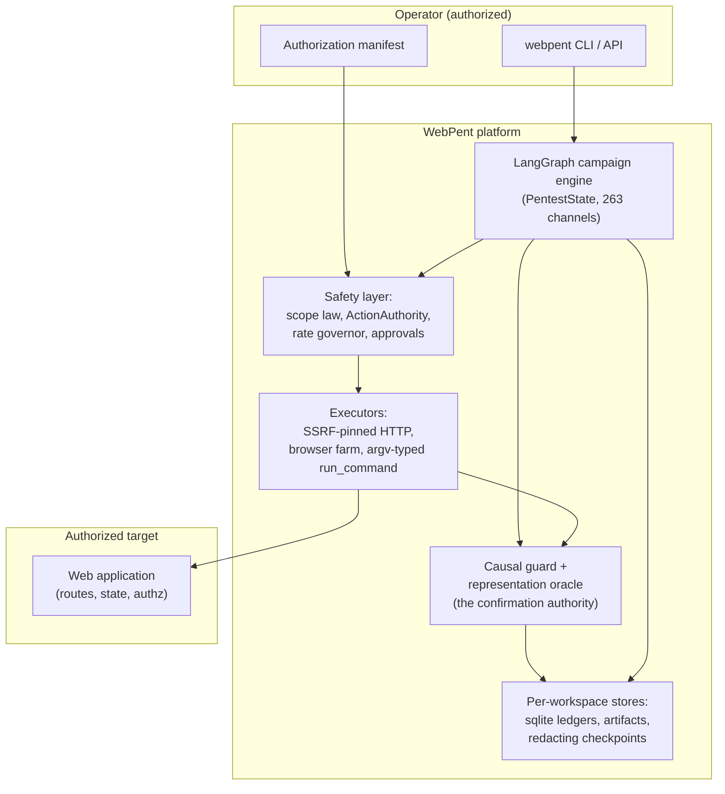
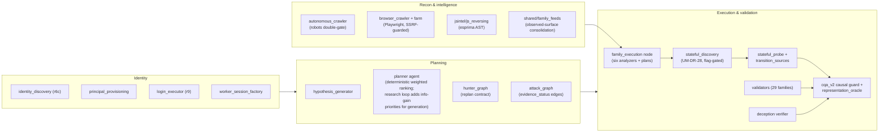
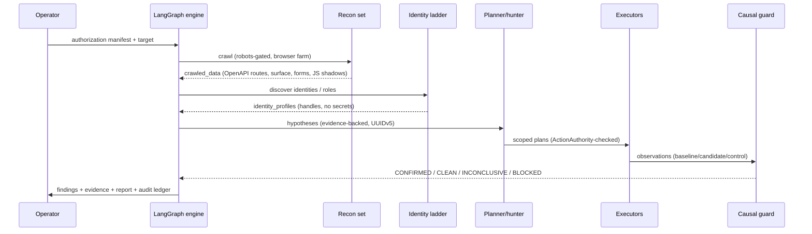
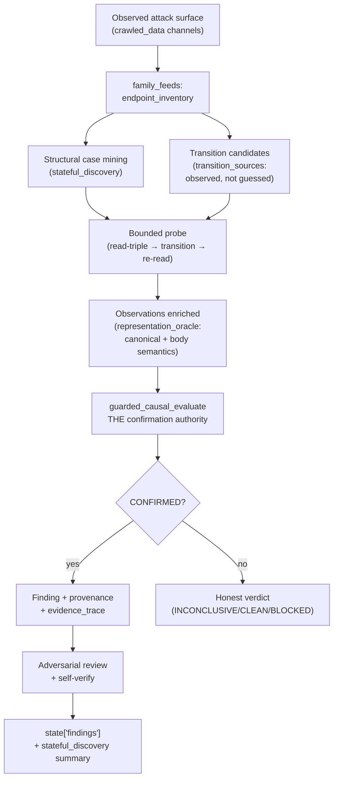
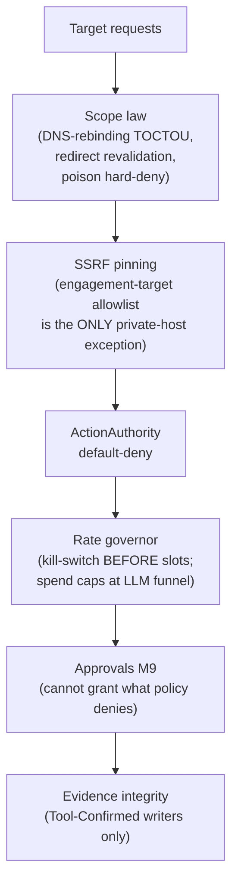

# WEBPENT MASTER GUIDE

**The complete product and technical guide.** Status date: 2026-11-08
(post UM-DR-31.1, v0.37.1 unified lineage). Companion evidence document:
`WEBPENT_ENGINEERING_REFERENCE.md` (Document 2). Canonical engineering
records: `docs/PROJECT_ARCHITECTURE_AND_ENGINEERING.md` (Document A),
`docs/DETECTION_INTELLIGENCE_AND_CAPABILITY.md` (Document B),
`DRIFT_REGISTER.md` (UM-DR-01…31.1), `BUILD_INFO.json`.

**Reading rule (honesty first):** every capability claim below carries
its real status from the defined ladders. Integration ladder:
Implemented → Unit-tested → Campaign-integrated → Target-validated →
Independently validated → Production-qualified. Capability ladder:
Proven / Partial / Implemented-Unverified / Planned / Absent. A passing
unit test is NOT real-world detection capability; an authored fixture
is NOT an independent holdout. Where runtime behavior was not verified,
it says NOT VERIFIED.

---

## 1. Executive Overview

**What WebPent is.** An autonomous, evidence-driven web-application
penetration-testing PLATFORM. A LangGraph state machine orchestrates
reconnaissance, identity discovery, attack-surface modeling, hypothesis
generation, attack planning, payload execution, causal validation, and
reporting — under an authorization manifest, scope law, safety
governors, and a tamper-evident audit spine. The unit of truth is the
**Finding with reproducible evidence**: nothing is a finding until a
deterministic validator (the causal guard) confirms it causally, with a
negative control refusing.

**The problem it addresses.** Real vulnerabilities — especially
authorization and business-logic bugs — are stateful, multi-step, and
hidden behind clean-looking responses. Classic scanners send single
probes and pattern-match responses; they cannot (a) discover the state
transitions a target requires, (b) represent authorization semantics
that appear in different response shapes, or (c) prove causality.
WebPent is built around exactly those three gaps.

**Intended users.** Security engineers and pentesters running
authorized engagements (authorization manifest mandatory); platform
engineers operating the campaign workers; researchers extending the
detection intelligence.

**Inputs and outputs.** Input: a target origin + an authorization
manifest (+ optional credentials, scope files, OpenAPI documents).
Output: findings with severity, reproducible evidence (request/response
traces, causal differentials, ProofBundles), campaign reports, and
audit ledgers.

**Current capabilities (verified).** Deterministic detection of 29
registered validator families; grammar-free stateful discovery
CAMPAIGN-INTEGRATED (UM-DR-28) — it mines read-triples from the
observed surface, applies discovered transitions, and confirms through
the causal guard; a representation-equivalence oracle that reads
authorization semantics from headers AND structured bodies; identity
ladders (anonymous → roles); deception-resistant verification
(production_qualified — the only component at that label); the full
family-spine output contract surviving to the campaign report
(UM-DR-30: all 20 output keys declared — status, candidates, plans,
validation results, sealed ProofBundles, observed capabilities); a
runtime coverage gap map (UM-DR-30, flag-gated — the campaign sees
where it did NOT look: not_scanned / blocked / policy_block /
missing-validator cells, bounded and advisory); an advisory
business-invariant review (UM-DR-30 — workflow observations checked
against conservative invariants; candidate signals whose validation
contract names the causal guard; never promotes); and — **the UM-DR-31
step** — an evidence-driven adaptive research loop (flag-gated,
`production/adaptive_research.py`): the coverage-gap, invariant and
workflow-boundary signals are now CONSUMED, turned into deduplicated
evidence-backed hypotheses in the real pool, ranked by the unchanged
strategist planner, and — through priority hints derived from observed
authorization boundaries — direct the stateful execution budget at
signal-rich areas first. Demonstrated end-to-end on a controlled
two-directory target (four-arm ablation: the hinted arms reach the
ground truth under a budget the alphabetical baseline cannot; zero
false positives in every arm).

**Boundaries and limitations (honest).** The deterministic engine is
lab_qualified (authored fixture corpora: replica / generalization /
equivalence at 1.0/1.0 — see §7); the recorded blind_v3 baseline is
0.137 and the original target is absent, so the in-repo numbers never
claim real-world generalization. **INDEPENDENT HOLDOUT: NOT
AVAILABLE** — the M10 production label waits on operator-deployed
corpora. Network-layer and client-side-beyond-DOM bugs are out of
scope. The LLM hypothesis path is refused by the Charter gate
(measured below its thresholds).

## 2. Complete System Architecture

### 2.1 System context

### 2.2 Component architecture (verified implementation)

### 2.3 Main execution architecture (a campaign)

### 2.4 Internal data flow (detection-critical path)

### 2.5 Agent orchestration architecture

Load-bearing, fully wired agents: planner, hunter (replan loop),
validator, recon crawler set, identity ladder, reporter. Advisory-only
(flag-gated, fail-soft, provenance-preserved): cve_advisory,
api_surface_shadow, coverage advisory, refutation-learning,
stateful_api plans. **Consolidation rule (directive §8.1):** no new
agent while an existing component can own the capability — UM-DR-27/28
deliberately extended the prober instead of adding a "stateful agent".

### 2.6 Security and authorization boundaries

Trust boundaries: operator→platform (authorization manifest, signed);
platform→target (all egress through the guarded executors); LLM→platform
(advisory only, behind the ToolBoundary and prompt-injection rules —
target content is untrusted text, never instructions).

## 3. Feature and Capability Overview (by subsystem)

| Subsystem | What it does | Key components | Status |
|---|---|---|---|
| Recon & crawling | robots-gated crawling, JS-heavy browser crawling, JS AST reversing | `recon/autonomous_crawler.py`, `browser_crawler.py`, `jsintel/js_reversing.py` | IMPLEMENTED_AND_WIRED, TESTED (adversarial suites) |
| Identity | two-branch identity discovery, principal rollup, login validation, reauth vault | `recon/identity_discovery.py`, `principal_provisioning.py`, `login_executor.py`, `auth/worker_session_factory.py` | IMPLEMENTED_AND_WIRED, TESTED (r6c/r9 suites) |
| Attack-surface consolidation | merges OpenAPI/crawl/forms/JS-shadows into one inventory with provenance | `shared/family_feeds.py` | IMPLEMENTED_AND_WIRED, TESTED |
| Family detection spine | six passive analyzers → execution plans → deterministic validators → ProofBundle → promotion | `families/execution_node.py` (wired behind `enable_family_execution_spine`) | IMPLEMENTED_AND_WIRED; full output contract declared and surviving (UM-DR-30 — the channel-drop residual CLOSED) |
| Coverage gap map | projects the final campaign state through the coverage ledger into an explicit, bounded, advisory gap report | `production/coverage_gap_report.py` + `coverage/coverage_map.py` + `gap_detector.py` (UM-DR-30, flag-gated fail-closed) | **CAMPAIGN-INTEGRATED (UM-DR-30)**; advisory only, no finding vocabulary |
| Business-invariant review | conservative invariants over workflow observations (destructive replay, missing auth context, denied-scope processing) | `business_logic/invariant_checker.py` wired into the fuzzer workflow enrichment (UM-DR-30) | **CAMPAIGN-INTEGRATED (UM-DR-30)**; advisory candidate signals, never promotes |
| Adaptive research loop | signal inventory (classified per an explicit, tested contract — 7 canonical classes + a fail-closed unknown-status bucket) → deduplicated evidence-backed hypotheses → the real strategist pool → research hints for the stateful execution budget (exact workflow-directory hints + coverage-surface hints, UM-DR-31.1) | `production/adaptive_research.py` wired ahead of the strategist on six conditional routes behind `enable_adaptive_research_loop` (UM-DR-31, fail-closed default False) | **CAMPAIGN-DEMONSTRATED (UM-DR-31/31.1)**: four-arm ablation on a controlled live target — the hinted arms reach the ground truth under a constrained budget the alphabetical baseline cannot; since UM-DR-31.1 the coverage-only arm reaches it too (the scheduling fix; identical budget, ordering only); zero false positives in every arm; bounded 3×12, non-promoting by construction |
| Stateful discovery | mines read-triples from the observed surface, applies discovered transitions, confirms causally | `production/stateful_discovery.py` + `stateful_probe.py` + `transition_sources.py` (UM-DR-27/28) | **CAMPAIGN-INTEGRATED (UM-DR-28), Target-validated on authored targets; lab_qualified** |
| Representation equivalence | reads authorization semantics from headers AND structured bodies; canonical normalization | `cqa_v2/representation_oracle.py` + the guard's channel fallback | IMPLEMENTED_AND_WIRED; Target-validated on the equivalence fixture (0.0→1.0, 0 FP) |
| Confirmation authority | deterministic causal differential with negative controls | `cqa_v2/causal_guard.py` (frozen) | IMPLEMENTED_AND_WIRED, TESTED, adversarially pinned |
| Deception resistance | baseline/candidate/control(+repeat), structural signatures, one-way verdicts | `deception/` | **Proven — production_qualified** (24/24, blind 8/8) |
| Stateful API engine (M5) | OpenAPI contract ingestion, dependency inference, bounded sequence plans, two-identity BOLA plans | `stateful_api/` | IMPLEMENTED_AND_WIRED (planning); live sequence execution deferred (owner recorded) |
| Safety & governance | scope law, SSRF, ActionAuthority, rate governor, approvals, spend caps | `safety/`, `shared/`, `approvals/` | IMPLEMENTED_AND_WIRED, TESTED (adversarial) |
| Persistence & reporting | per-workspace sqlite, redacting checkpoints, ledgers, reports, POC recorder | `memory/db.py`, `graph/checkpoints.py`, `reporter/` | IMPLEMENTED_AND_WIRED, TESTED |

## 4. AI Agent Intelligence

**LLM architecture.** Multi-provider (`llm_researcher/`) behind the
ToolBoundary, structured-output schemas, spend caps, and the
prompt-injection boundary. **LLMs never** determine authorization,
expand scope, confirm findings, or bypass gates. **LLMs may** propose
hypotheses, interpret behavior, suggest candidates, classify causes —
always as advisories with provenance.

**The coverage classification contract (UM-DR-31.1 R6).** One pure,
tested function (`classify_coverage_status`) maps a ledger cell to
exactly one of eight classes — seven canonical + one fail-closed
unknown bucket. Actionable (research value): `observed_not_tested`,
`tested_inconclusive`, `blocked_operational`. Non-actionable:
`blocked_policy`, `non_actionable`, `tested_rejected`,
`confirmed_vulnerability`. Fail-closed: `unknown_status` (any
unrecognized status is classified, counted and recorded — never
silently converted into an executable opportunity). A `candidate` cell
is non-actionable: it is owned by the causal/human pipeline, not an
unexplored area.

**Deterministic-vs-LLM split (verified):** every finding-producing
decision is deterministic (the causal guard). The Charter §4.1 gate
REFUSES the LLM hypothesis path budget today: the recorded measurement
(recall 0.3425, precision 0.5556) is below the gate thresholds (≥0.5 /
≥0.7 on ≥30 samples, beating the deterministic baseline) — fail-closed
by construction.

**Planning and adaptation (deterministic, evidence-backed):**
hypotheses carry preconditions/alternatives/expected behavior/negative
controls/info-gain. Precision of wording (audit F14): the planner's
ranking formula is a deterministic weighted score (severity, confidence,
evidence, cost, novelty, criticality) — info-gain does NOT enter that
formula; info-gain priors drive the RESEARCH LOOP's generation
prioritization (which candidates survive the per-iteration cap) and the
stateful discovery's hint ordering. The hunter
replan contract routes first-attempt REFUTED to replan-once without
re-exploiting; refutation learning records validator outcomes and feeds
the planner advisory. The stateful prober ADAPTS: bounded control
rotation searches for an enforced negative control when the structural
first guess is a clean-looking trap (UM-DR-28) — measured, bounded (≤2
rotations), guard-authoritative.

**Memory.** Attack memory + adversarial review (downgrades findings
with surviving benign explanations — only downgrades, never promotes);
self-verify engine (confidence scoring; unverifiable findings move to
needs_review, never reported confirmed); lesson extraction after
reflection; the A/B lesson lab (atomic claims, P1-02/P1-08 policies —
P102's designed concurrent no-op documented UM-DR-28).

**Human intervention.** HITL interrupts before scope review and the
execution sandbox; approvals tier 0–3 with immutable bindings;
M10's remediation PR flow (preserved, advisory) requires mandatory
human review by design.

## 5. Autonomous Bug Hunting Lifecycle (the real run)

1. **Target input + authorization manifest** (mandatory; sign-time
   refusal without it).
2. **Scope validation** (origin-level coverage, TOCTOU revalidation).
3. **Workspace** (per engagement/target isolation, fail-closed
   switching).
4. **Reconnaissance** (robots-gated crawl; browser farm for JS-heavy
   targets; JS AST reversing; OpenAPI intake).
5. **Attack-surface consolidation** (family_feeds precedence).
6. **Application understanding** (appmodel with discovery confidence;
   identity ladder).
7. **Hypothesis generation** (evidence-backed records; advisories).
8. **Task planning** (deterministic weighted ranking; the research loop's
   info-gain priors order hypothesis GENERATION and the stateful budget;
   coverage advisory flag-gated).
9. **Attack-path exploration** (hunter loop with replan contract;
   attack-graph edges carry evidence_status).
10. **Tool selection** (validators by vuln_class; stateful discovery
    when the surface carries stateful routes).
11. **Test execution** (SSRF-pinned executors; the stateful prober's
    bounded transitions — DELETE refused, ≥400 skipped, budgets
    enforced and reported).
12. **Feedback analysis** (observations enriched by the representation
    oracle — headers OR bodies).
13. **Adaptive replanning** (REFUTED → replan-once; control rotation;
    refutation learning).
14. **Vulnerability verification** (the causal guard: baseline /
    candidate / control with the negative control refusing; deception
    verifier for hostile targets).
15. **Evidence preservation** (ordered evidence_trace: every read with
    digests/verdicts/observed context, every transition with
    method/path/status; ProofBundle sealing; replay).
16. **Finding classification** (adversarial review + self-verify;
    promotion only for survivors).
17. **Report generation** (executive summary, risk scoring, reporter).

Where the current implementation stops short of the vision, §7 says so
explicitly.

## 6. What Makes WebPent Different? (each claim evidence-linked)

- **Grammar-free stateful discovery** — transitions come from the
  OBSERVED surface (OpenAPI/crawl/forms/JS), not name-guessing.
  Evidence: the generalization fixture's grammar control measured
  **+0.0000** for name-guessing vs **1.0/1.0** for observed-source
  (UM-DR-27); now campaign-integrated and proven E2E on a structurally
  different target (UM-DR-28).
- **Representation-equivalent authorization reading** — the same
  semantic fact is recognized across headers, flat fields, and nested
  objects, with adversarial pins against over-normalization.
  Evidence: equivalence fixture 0.0 → 1.0 at 0 FP (UM-DR-28).
- **Deterministic verification with negative controls** — the causal
  guard is the only confirmation authority; an HTTP difference alone is
  never a finding.
- **Deception resistance** — 24/24 fixture rejection, blind 8/8, 0 FP
  (production_qualified — the only component at that label).
- **Evidence integrity** — ordered, complete, replayable traces; no
  transition silently disappears; Tool-Confirmed provenance.
- **Fail-closed everything** — flags default off; unknown
  representations yield honest INCONCLUSIVE, never guessed
  confirmations.

Not claimed without controlled comparison: superiority over commercial
scanners (no comparative benchmark exists); real-world generalization
(no independent holdout).

## 7. Strengths, Weaknesses, Limitations

**Verified strengths.** The confirmation discipline (guard + negative
controls + deception verifier); the discovery generalization mechanism
(measured control vs treatment); the freeze/refreeze engineering
discipline (declared, self-verifying); the honest measurement culture
(genealogy tables, never-merged populations, labeled honesty
boundaries); 8,903-test suite green with machine gates (frozen-module
byte identity, broad-exception register, direct-I/O inventory) — the
UM-DR-32 window (see §12 and `docs/engineering/umdr32/`) added the
object-identity/alias/multi-identity/composite-workflow capability
line, the privilege_differential validator-route closure, and the
six-arm controlled evaluation (baseline 0/4 → unified 4/4 at precision
1.0 under equivalent budgets; historical context: the UM-DR-31 window
measured 8,711 tests, the UM-DR-31.1 window 8,744 — both labeled
historical records).

**Verified weaknesses / engineering debt.** The family spine's
non-findings output keys are channel-dropped — **CLOSED by UM-DR-30**
(all 20 output keys declared; LangGraph survival proven through the
real wiring and the real family_feeds data route); `run_campaign.sh`
was rebuilt on the real CLI contract and the langgraph CVE backlog
closed as resolved-by-pinning (zero advisories on the exact-pinned
family; dnspython 2.8.0→2.9.2) — **both 0.34.2 items CLOSED**;
remaining debt: the M5 differential plans' live sequence execution is
deferred; the body-alias vocabulary is minimal and English-conventioned;
the advisory channels' replanning consumption — **CLOSED by UM-DR-31**
(the coverage-gap, invariant and workflow-boundary signals now flow
through the adaptive research loop into the real planner pool and the
stateful execution priority; the loop's own measurable contribution is
pinned by the four-arm ablation); remaining: coverage-ledger signals
enrich the planner pool but do not reorder stateful execution (the
ledger is class-shaped, not directory-shaped — recorded as a design
boundary); the knowledge-graph→planning loop and the isolated
adaptive-research-planner layer remain unwired.

**Benchmark limitations.** All in-repo corpora are team-authored
(author-known). The recorded original-target baseline (0.137) cannot be
re-measured (target absent). The M10 label requires operator-deployed
independent corpora: **NOT AVAILABLE**.

**Scalability/operations.** Campaign workers + cross-process leases +
concurrency governor exist and are tested; notification transports are
operator-side; a full 45-node LLM campaign run was not executed
in-repo (operator credentials) — the LangGraph integration is proven at
the wiring level (UM-DR-28 E2E).

## 8. Practical Execution Walkthrough (authorized lab scenario)

Target: the UM-DR-28 E2E ledger application
(`benchmarks/campaign_stateful_target.py` — controlled, ground-truthed).
1. WebPent crawls `GET /openapi.json` → `crawled_data.openapi_routes`
   (9 reads + 5 stateful routes + decoy + out-of-scope area).
2. family_feeds consolidates the inventory; the family_execution node
   runs (spine flag on) and, with `enable_stateful_discovery`, mines 9
   read-triple cases.
3. Scope: the 2 `/internal/` cases are refused before any request.
4. The prober reads each triple; traps (clean-looking granted responses)
   are INCONCLUSIVE; it applies the OBSERVED token transitions
   (`settle_9f3a1_3`, `commit_76c09_5`, `pend_07df1_6` +
   `close_67d48_6`), re-reads, and rotates the control when the
   structural control is itself a trap.
5. The enriched observations carry body semantics (`owner`,
   `effective_as`) → the guard confirms 3/3 ground-truth vulns; the 4
   safe accounts and the decoy never confirm.
6. Findings (IDOR ×2, AUTH_BYPASS ×1) survive the adversarial review +
   self-verify, land in `state["findings"]`, with the full ordered
   evidence trace and the campaign summary on the
   `stateful_discovery` channel.

Evidence: `tests/test_umdr28_campaign_stateful_e2e.py` (10),
`reports/qualification/umdr28_campaign_e2e.json`.

## 9. Technology Overview

Python 3.12; **LangGraph** (the campaign state machine, checkpointer
with secret redaction); **httpx** (SSRF-pinned transports);
**Playwright** (browser farm); **esprima** (JS AST); **pydantic**
(contracts); **sqlite** (per-workspace stores, ledgers, A/B lab);
**alembic** (migrations); **structlog** (structured logging); Celery
(worker queues); pytest (8,661 tests). Rationale per subsystem in
Document A §2–§3. Dependencies are deliberately few at the core; the
LLM layer is optional and refuses to run ungated.

## 10. Glossary (selected)

- **Causal guard** — `guarded_causal_evaluate`: the only deterministic
  confirmation authority; requires the observable differential with the
  negative control refusing.
- **Representation-equivalence oracle** — recognizes the same
  authorization semantics across different response representations
  (headers vs body fields), with adversarial no-over-normalization
  pins.
- **Transition source** — where transition candidates come from
  (observed surface vs the legacy name grammar).
- **Control rotation** — bounded adaptive search for an enforced
  negative control.
- **Trap** — a clean-looking response that hides a vulnerable state
  until transitions apply.
- **Evidence trace** — the ordered causal history attached to every
  probe outcome.
- **Freeze/refreeze (DR-009)** — byte-identity manifest for protected
  files; changes require a declared, self-verifying script.
- **lab_qualified / production_qualified** — the M11 honesty labels
  (authored corpora vs independent operator-deployed holdouts).

## 11. Project Maturity Summary

| Dimension | Assessment | Evidence anchor |
|---|---|---|
| Architectural | High — layered, flag-gated, freeze-disciplined | Document A; frozen gate 639 (UM-DR-29 disposition, 5-path UM-DR-30 refreeze) |
| Dead-code hygiene | High — 24 dead packages archived (UM-DR-29), zero duplicate implementations in src | archive/umdr29_dead_code/README.md + UMDR29 gap analysis |
| Capability wiring | High — the family spine's 20 output keys declared (UM-DR-30 closed the silent-drop class); coverage gap map + invariant review campaign-wired | UMDR30_FEATURE_QUALIFICATION_MATRIX.json + 66 window tests |
| AI-agent engineering | Solid, deliberately bounded — LLM advisory-only, deterministic authority | Charter gate record |
| Bug-hunting capability | Strong on authored corpora (stateful + representation classes at 1.0/1.0); real-world = NOT VERIFIED | RCA §1 genealogy, §6 |
| Autonomy | Bounded autonomy inside authorization — flags, budgets, kill switches, HITL | Safety suites |
| Verification | The strongest dimension — causal guard, deception 24/24, evidence traces | Deception benchmark |
| Security | Defense-in-depth at every boundary, adversarially tested | M2/M9/M12 reports |
| Benchmark honesty | High — never-merged populations, labeled boundaries | M11 contract |
| Operational | Worker/lease/concurrency tested; notifications + full LLM run operator-side | M12, campaign suites |

## 12. UM-DR-32 — Object Identity, Aliases, Multi-Identity & Business Logic

**Window:** 2026-11-09, package 0.38.0. Full evidence package:
`docs/engineering/umdr32/` (11 deliverables) +
`reports/qualification/umdr32_benchmark.json`.

What changed, in one paragraph each:

1. **Object identity intelligence** (`production/object_identity.py`):
   identities anchor on (tenant, resource_type, stable object id) —
   never the URL path; merges need corroborating evidence (id equality
   alone never merges); weak evidence abstains; conflicts are preserved.
   Status: IMPLEMENTED_AND_WIRED, TESTED, campaign-demonstrated on the
   controlled lab (resolution 4/4 alias pairs at zero false merges).
2. **Alias resolution** (`production/alias_resolution.py`): a reversible
   six-state overlay over the registry, evidence-only candidates,
   security-aware guards (tenant/type/query-value boundaries; the
   UM-DR-31.1 F10/F11 fingerprint contract non-regressed).
3. **Multi-identity reasoning** (`production/multi_identity.py`):
   pseudonymous principals (no raw credentials by construction), the
   principal x tenant x object x operation x state matrix, differential
   questions that REQUIRE a denied negative control, and the
   **privilege_differential validator-route closure** — the
   UM-DR-31.1 missing-validator wall is gone (registry + experiment
   fabric + typed triple + session-isolation fail-safe).
4. **Composite business-logic workflows**
   (`production/composite_workflows.py`): workflows from OBSERVED
   transitions only; bounded sequences with evidence-backed invariants;
   the FixtureSafetyContract (destructive steps require
   resettable+isolated+operator-authorized); two evaluation routes
   INSIDE the existing validation architecture (CausalGuard for
   same-actor state evidence; the registered privilege validator for
   cross-actor evidence). The engine never promotes.
5. **The unified node** (`production/identity_workflow.py`): one
   flag-gated advisory node on the composed redirect chain
   (identity_workflow -> research_loop -> strategist), six declared
   state channels, deterministic pool-deduped hypotheses, and
   ordering-only identity hints consumed by stateful discovery (same
   budget). Flag-off = byte-comparable graph (test-enforced).
6. **Engineering integrity**: portable deterministic archive builder
   (root + nested layouts, documented exclusion policy), portable suite
   runner (nonzero exit on any failed/unexecuted chunk), the experiment
   provenance contract (dirty-tree rejection), version identity
   reconciliation (0.34.0 historical / 0.38.0 current / v15.2 label),
   the origin-scheme admission fix (https origin no longer admits http
   endpoints), exact test accounting (8,744 -> 8,903 unique IDs,
   8,894/0/6/3), and the documented 6-file refreeze + 5 new frozen
   modules.

**Measured (the controlled six-arm lab, team-authored fixture,
equivalent budgets):** baseline 0/4 ground-truth scenarios -> unified
4/4 at precision 1.0, recall 1.0, zero false positives in EVERY arm,
deterministic on repeats. Resolution and detection metrics are reported
separately (understanding alone detects nothing — the measured
dependency chain). M10 remains CLOSED (holdout
BLOCKED_EXTERNAL_DEPENDENCY); the lab is mechanism validation, not
independent validation.

— appended by the UM-DR-32 window —

— End of WEBPENT_MASTER_GUIDE (Document 1) —
